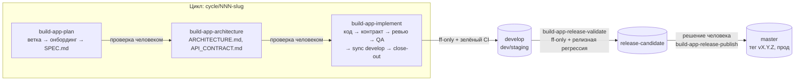
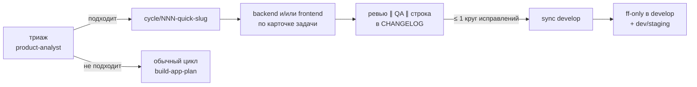

# Enterprise-команда разработки на агентах Claude Code

Классическая enterprise-команда разработки, собранная из субагентов Claude
Code: продуктовый аналитик, архитектор, backend- и frontend-разработчики,
ревьюер, QA, DevOps, технический писатель и юрист — с теми же ролями,
границами ответственности и процессом, что в реальной компании. Работа идёт
циклами по модели веток `cycle → develop → release-candidate → master`,
с точками проверки человеком там, где ошибка дешевле всего, и с
механическими гейтами (git-хуки + CI) поверх промпт-инструкций.

**Для кого.** Для разработчиков и небольших команд, которые уже работают в
Claude Code и хотят, чтобы путь «идея → ТЗ → архитектура → код → ревью →
тесты → интеграция → релиз» проходил по понятному регламенту, а не одним
длинным диалогом с одним агентом. Подходит и для нового проекта с нуля, и
для подключения к уже существующему (в том числе наполовину готовому)
сервису.

**Что внутри.**

- `.claude/agents/` — 10 ролей-субагентов (системный промпт роли, модель,
  effort, права, инструменты).
- `.claude/workflows/` — 6 сценариев для инструмента Workflow: три этапа
  цикла (план → архитектура → реализация), быстрый флоу для маленьких фич
  одним прогоном и два этапа релиза (проверка → публикация).
- `.claude/skills/` — проектные навыки, преднагружаемые в конкретные роли.
- `.githooks/` — защита веток, сканирование секретов, обязательный зелёный
  CI перед пушем в защищённые ветки.
- `tools/summarize_metrics.py` — сводка метрик расхода токенов по циклам.
- [GETTING_STARTED.md](GETTING_STARTED.md) — пошаговая шпаргалка с готовыми
  фразами для ручного режима.
- [docs/HISTORY.md](docs/HISTORY.md) — история проектных решений и их
  обоснования.

## Состав команды

| Роль в компании | Агент | Что делает | Когда вызывается |
|---|---|---|---|
| Системный аналитик / техлид на онбординге | `codebase-analyst` | Существующий код → карта текущего состояния (CURRENT_STATE.md) | Для существующего проекта — первым после создания cycle-ветки, до product-analyst; в конце каждого цикла — обновление CURRENT_STATE.md (close-out) |
| Продуктовый / бизнес-аналитик | `product-analyst` | Идея → ТЗ (SPEC.md); changelog и описание продукта для людей вне команды | После того как devops-engineer создал cycle-ветку (для существующего проекта — после codebase-analyst и базового прогона QA); второй раз — в close-out цикла (README «О проекте» + `Unreleased` в CHANGELOG); третий — на релизе (закрытие версии в CHANGELOG) |
| Архитектор решений | `architect` | ТЗ → архитектура, модель данных, API-контракт + машиночитаемая схема | После согласования SPEC.md человеком |
| Backend-разработчик | `backend-developer` | Сервер по контракту, unit-тесты | Параллельно с frontend |
| Frontend-разработчик | `frontend-developer` | UI по контракту, unit-тесты | Параллельно с backend |
| Senior-разработчик на code review | `code-reviewer` | Баги, безопасность, соответствие архитектуре до тестов | После контрактной проверки; recheck после исправлений; ревью после мерджа `develop → cycle` |
| QA-инженер | `qa-engineer` | Функциональные/e2e-тесты, регрессия, критерии приёмки, контрактная проверка | Базовый прогон (существующий проект), финальная проверка, регрессия после подтягивания `develop`, релизная регрессия; контрактная проверка — после реализации и после подтягивания `develop` |
| DevOps / релиз-инженер | `devops-engineer` | Сборка, CI/CD, деплой; владелец веток, мерджей, тегов; фиксация документов агентов без Bash | Вызов 0 — один раз на проект; Вызов 1 и Вызов 2 — в каждом цикле (плюс короткие «Фиксации документов»); Вызов 3 — на событие релиза |
| Технический писатель | `technical-writer` | Пользовательские гайды, онбординг, база знаний | В момент релиза — до мерджа в `master`, на релизной cycle-ветке, после закрытия версии в CHANGELOG |
| Юрист | `legal-counsel` | Право РФ: персональные данные (152-ФЗ), политика конфиденциальности, оферта, общие юридические вопросы | По требованию — вне обычного конвейера; явно человеком или по приглашению product-analyst |

Тестовая пирамида разделена по уровням, а не по тому, кто быстрее успеет:
разработчики пишут unit-тесты на свою логику сразу при реализации, а
`qa-engineer` отвечает только за функциональные/e2e-тесты, которые пишет по
SPEC.md независимо от реализации — тесты, написанные с оглядкой на код,
наследуют слепые пятна разработчика.

Каждый агент — файл в `.claude/agents/`: YAML-фронтматтер (`name`,
`description`, `tools`, `model`, `effort`, `permissionMode`, опционально
`skills`) + системный промпт с ролью и правилами. По `description` Claude
Code может сам выбрать, кому делегировать задачу, но для конвейера, где
порядок критичен, надёжнее вызывать агентов явно.

## Процесс



Между каждой парой этапов — осознанная остановка: человек читает SPEC.md
(особенно блок критичных предположений product-analyst), затем архитектуру,
и только потом запускает следующий этап. Ошибка в спеке или архитектуре,
замеченная на этом шаге, стоит часы; замеченная после того, как по ней
написан код, — часто означает переписывать реализацию. Прод-деплой —
отдельное решение человека после зелёной релизной регрессии, а не
автоматическое продолжение.

Для маленьких фич, которым эта проработка не нужна, есть **быстрый флоу**
`build-app-quick` — см. [ниже](#быстрый-флоу-для-маленьких-фич).

## Требования

- **Claude Code** с поддержкой субагентов; для автоматического режима —
  с инструментом **Workflow** (ручной режим по
  [GETTING_STARTED.md](GETTING_STARTED.md) работает и без него).
- **git** и репозиторий на **GitHub** с **GitHub Actions** (минимальный CI
  devops-engineer добавляет сам первым коммитом первой cycle-ветки).
- **gh** (GitHub CLI), авторизованный через `gh auth login` — нужен хуку
  `pre-push` для проверки CI (check-runs и классические commit statuses);
  хук обращается к `gh` только при пуше в защищённую ветку.
- **gitleaks** — опционально, для полноценного сканирования секретов в
  `pre-commit` (без него работает упрощённая встроенная проверка).
- **python3** — опционально, для `tools/summarize_metrics.py`.

## Установка

1. Скопируйте всю папку `.claude/` (`agents/`, `workflows/`, `skills/`) в
   корень целевого проекта. Альтернатива — положить `agents/` и `skills/` в
   `~/.claude/`, чтобы команда была доступна во всех проектах; `workflows/`
   при этом остаются на уровне проекта.
2. Скопируйте `.githooks/` в корень проекта и включите хуки:
   ```
   git config core.hooksPath .githooks
   ```
   В существующем репозитории это можно сделать сразу. При старте с нуля
   оставьте настройку devops-engineer (см. ниже): хуки включаются после
   начального коммита.
3. Опционально — `tools/summarize_metrics.py` для сводки метрик.
4. Проверьте, что агенты подхватились: спросите в чате «Какие саб-агенты
   доступны в этом проекте?» или выполните `/agents` — должно быть 10 ролей.

**Старт с нуля (greenfield).** Если репозитория или ветки `develop` ещё нет,
devops-engineer выполняет **Вызов 0 — подготовку репозитория** (один раз на
проект): `git init` при необходимости, начальный коммит (только если
коммитов ещё нет) — до включения хуков, основная ветка (`master`, либо
существующая `main` в той же роли), ветка `develop`, `git config
core.hooksPath .githooks` и первый пуш. `build-app-plan.js` сам доходит до
этого: devops-engineer, обнаружив, что `develop` нет, выполняет Вызов 0
перед Вызовом 1. Первый пуш защищённых веток, когда CI ещё ни разу не
запускался, — **единственный легитимный случай** обхода проверки CI:

```
ALLOW_NO_CI_CHECK=1 git push origin master develop
```

Сам CI в защищённые ветки напрямую не коммитится: минимальный workflow
GitHub Actions (сборка + тесты/линт на push во все ветки) devops-engineer
добавляет первым коммитом первой cycle-ветки (Вызов 1), и в `develop` он
попадает обычным путём — через интеграцию цикла. Во всех остальных случаях
`pre-push` должен находить зелёный прогон CI.

## Быстрый старт

### Автоматический режим (Workflow)

Сценарии запускаются инструментом Workflow по имени (`meta.name` в скрипте),
каждый — отдельным вызовом; результат предыдущего этапа передаётся в `args`
следующего как есть. Общий лимит токенов задаётся директивой вида `+500k` при
запуске — без неё бюджет не ограничен.

**Цикл:**

1. `build-app-plan` — cycle-ветка, онбординг (если проект существующий),
   SPEC.md, «Фиксация документов».
   ```js
   { idea: 'Сервис записи к врачу: ...', existingProject: false }
   // опционально: size: 'small' — облегчённый режим для малых правок
   ```
   Возвращает `{ branch, currentState, baseline, spec, size, firstOnboarding, blocked }`.
   **Остановка:** прочитайте SPEC.md, при необходимости поправьте файл в
   репозитории.
2. `build-app-architecture` — `args`: результат шага 1 целиком.
   ARCHITECTURE.md, API_CONTRACT.md, машиночитаемая схема контракта,
   «Фиксация документов». **Остановка:** прочитайте архитектуру.
3. `build-app-implement` — `args`: результат шага 2 целиком (включая
   `size` и `firstOnboarding`, который приходит из результата
   `build-app-plan` и включает у code-reviewer базовый аудит всей кодовой
   базы только при первом подключении к проекту). Реализация → интеграция в
   `develop` → деплой в dev/staging.

Правки SPEC.md/архитектуры между этапами делаются в файлах репозитория:
агентам передаются пути и короткая выжимка, полный текст они читают сами.

**Релиз** (когда решите выпускать; не на каждый цикл):

4. `build-app-release-validate` — `args` (необязательно): `{ version:
   '1.2.0' }`; без версии её определит devops-engineer. `develop →
   release-candidate` + релизная регрессия. **Остановка** для решения
   человека.
5. `build-app-release-publish` — `args`: результат шага 4 (`{ stage,
   releaseRegression }`) + необязательный `version`. Закрытие версии в CHANGELOG, гайды, `master`,
   тег, прод-деплой.

Если прогон остановился по бюджету (`blocked: 'budget'`) или упал из-за
разового сбоя — не перезапускайте с нуля, а резюмируйте через
`resumeFromRunId` (подробнее — в [GETTING_STARTED.md](GETTING_STARTED.md)).

### Быстрый флоу для маленьких фич

`build-app-quick` — для задачи, которая не требует проработки: правка в
уже существующем модуле без изменения модели данных и миграций,
API-контракта, авторизации, ПДн, платежей и без новых зависимостей, с
однозначными требованиями. Один запуск, без остановок на человека:



```js
{ idea: 'Добавить кнопку «Скопировать ссылку» на страницу заказа', existingProject: true }
```

Чем он дешевле обычного цикла:

| | Обычный цикл | `size: 'small'` | `build-app-quick` |
|---|---|---|---|
| Запусков / остановок на человека | 3 / 2 | 3 / 2 | 1 / 0 |
| SPEC.md, ARCHITECTURE.md | полные | короткие | нет — карточка задачи из триажа |
| Контрактная проверка | да | да | нет (смена контракта — недопуск) |
| Кругов исправлений | до 2 | до 2 | не больше 1 |
| Проверки после sync develop | ревью ∥ регрессия ∥ контракт | то же | регрессия затронутой области; ревью — только при конфликтах |
| CURRENT_STATE.md, README «О проекте» | обновляются | обновляются | нет — догонит следующий обычный цикл |

Защита от того, чтобы через быстрый флоу не проскочила «большая» задача, —
не человек, а явные критерии и право остановиться у каждого:
product-analyst на триаже отвечает `eligible: false`, разработчик —
`escalate: true` (ничего не коммитя), code-reviewer помечает выход за
критерии находкой `[не quick]`. Во всех этих случаях прогон
останавливается с `blocked: 'not-quick'` или `'escalate'` и в `develop`
ничего не попадает — запустите обычный цикл. Если ревью/QA не сошлись за
один круг исправлений — тоже остановка: маленькая задача, которая не
сходится с первого раза, обычно не такая маленькая.

### Ручной режим

Те же шаги, но каждого агента вы вызываете сами в чате и видите каждый
промежуточный результат — с этого стоит начинать на первых проектах. Готовые
фразы для каждого шага — в [GETTING_STARTED.md](GETTING_STARTED.md).

## Модели, effort, права и навыки ролей

`model` и `effort` во фронтматтере — настройки вызова именно этой роли, а не
вашей сессии: из сессии на Opus вызов `backend-developer` всё равно уйдёт на
`sonnet`/`low`. Переключать модель сессии вручную не нужно.

| Агент | Модель | Effort | Почему |
|---|---|---|---|
| `product-analyst` | opus | high | Синтез требований с нуля, взвешивание рисков |
| `architect` | opus | high | Проектное решение с нуля |
| `code-reviewer` | opus | high | Поиск неочевидных проблем в чужом коде |
| `legal-counsel` | opus | high | Точность формулировок по 152-ФЗ, цена ошибки высокая |
| `technical-writer` | opus | high | Качество текста для конечных пользователей |
| `codebase-analyst` | opus | medium | Разбор чужого кода по чёткой инструкции «что искать» |
| `qa-engineer` | sonnet | medium | Граничные случаи по готовым критериям приёмки |
| `backend-developer` | sonnet | low | Реализация по готовому контракту |
| `frontend-developer` | sonnet | low | То же — контракт задан architect'ом |
| `devops-engineer` | sonnet | low | Механические git/CI-операции по чёткой инструкции |

Логика: где роль придумывает решение с нуля или ищет неочевидное — сильнее
модель и выше effort; где работает по готовой спецификации — экономия не
увеличивает число кругов исправлений. Поднимать модель исполнителю, который
работает по чёткому контракту, имеет смысл только если на практике он
стабильно становится источником блокирующих находок.

**В Workflow** `model` из фронтматтера подхватывается через
`opts.agentType`, а `effort` — нет (известный пробел инструмента), поэтому
во всех скриптах `.claude/workflows/*.js` effort явно передаётся в
`opts.effort`. При ручном вызове субагента оба поля работают как обычно.

**permissionMode.** `backend-developer`, `frontend-developer`, `qa-engineer`,
`codebase-analyst` — `acceptEdits`; остальные — `default`. Ограничение:
если сама сессия работает в `bypassPermissions`, `acceptEdits` или `auto`,
субагент наследует этот режим и его собственный `permissionMode`
игнорируется. Поэтому при полностью автономном прогоне защитой от
неосознанного прод-деплоя остаётся разделение релиза на
`build-app-release-validate` / `build-app-release-publish`, а не права роли.

**skills.** Поле `skills` преднагружает навык в контекст роли при старте.
Сейчас в наборе один навык — `.claude/skills/design-taste-frontend/`,
подключённый к `frontend-developer`: правила против «типового AI-дизайна»
(дефолтные фиолетовые градиенты, однотипные карточки в ряд, сплошной
glassmorphism, эмодзи вместо иконок) и чек-лист перед генерацией UI. Новые
навыки под роли кладите в `.claude/skills/` и подключайте через `skills:` во
фронтматтере.

## Ветки и релизы

### Модель веток

- `master` (или существующая `main` в той же роли) — прод. Только из
  `release-candidate`, с тегом версии.
- `release-candidate` — предрелизная стадия; в неё приходит `develop`, когда
  решено резать релиз (после одного цикла или пачки — механика одна).
- `develop` — интеграционный ствол: только полностью завершённые циклы.
  Можно непрерывно деплоить в dev/staging.
- `cycle/<NNN>-<slug>` — одна ветка на цикл, от актуального `develop`. `NNN`
  devops-engineer вычисляет сам по существующим веткам; ветки после мерджа
  не удаляются — это история и аудит-след.

`master`, `release-candidate` и `develop` — **защищённые ветки**: в них
попадают только `--ff-only`-мерджи, которые выполняет devops-engineer.
Прямых коммитов в защищённые ветки нет ни у кого, включая devops. Всё, что
коммитится, коммитится на cycle-ветке. Благодаря `--ff-only` в защищённую
ветку попадает ровно тот SHA, который уже прошёл CI на исходной ветке, —
это и делает возможным механический CI-гейт на пуше без pull request.

### Кто что делает в git

| Кто | Что |
|---|---|
| `devops-engineer` | Создаёт ветки, подтягивает `develop` в cycle-ветку, мерджит (`--ff-only`), ставит теги, пушит в защищённые ветки, фиксирует документы агентов без Bash |
| `backend-developer`, `frontend-developer`, `qa-engineer`, `codebase-analyst`, `code-reviewer` (если правит код) | Коммитят свои изменения сами на текущей cycle-ветке. Ветки не создают, не переключают, не мерджат |
| `product-analyst`, `architect`, `technical-writer`, `legal-counsel` | Bash нет: пишут файлы, коммитит их devops-engineer («Фиксация документов») |

### Вызовы devops-engineer

- **Вызов 0 — подготовка репозитория** (один раз на проект), см.
  «Установка».
- **Вызов 1 — начало цикла:** `cycle/<NNN>-<slug>` от актуального `develop`,
  пуш; в первом цикле проекта — первым коммитом минимальный CI, если его ещё
  нет. Конвенцию именования devops-engineer определяет по существующим
  веткам (`git branch -a`).
- **Фиксация документов** (короткий вызов, effort low): отдельный коммит
  `docs: ...` с новыми/изменёнными документами агентов без Bash (SPEC.md,
  ARCHITECTURE.md, API_CONTRACT.md и схема, CHANGELOG.md, README.md,
  `docs/**`, юридические документы) на текущей cycle-ветке, пуш. Код не
  трогается. Вызывается в конце `build-app-plan` и `build-app-architecture`
  — человек проверяет уже закоммиченные документы — и автоматически в начале
  интеграции.
- **Вызов 2 — интеграция цикла:** (а) sync — подтянуть `develop` в
  cycle-ветку; (б) integrate — зафиксировать документы, запушить
  cycle-ветку, дождаться зелёного CI на этом SHA, `--ff-only` в `develop`,
  пуш, деплой в dev/staging. Возвращает структурированный результат
  `{ merged, sha, deployed, reason }`.
- **Вызов 3 — релиз** (не привязан к циклу), см. ниже.

### Порядок одного цикла

1. devops-engineer создаёт cycle-ветку (Вызов 1) — до того, как
   product-analyst начнёт писать SPEC.md.
2. Для существующего проекта: codebase-analyst (CURRENT_STATE.md) →
   базовый прогон QA. Затем product-analyst → SPEC.md → «Фиксация
   документов» → **проверка человеком**.
3. architect → ARCHITECTURE.md/API_CONTRACT.md/схема → «Фиксация
   документов» → **проверка человеком**.
4. backend/frontend параллельно → контрактная проверка QA (быстрый гейт до
   дорогого ревью) → code-reviewer → qa-engineer (финальная проверка), с
   кругами исправлений.
5. devops-engineer подтягивает `develop` в cycle-ветку. Если `develop` ушёл
   вперёд — **с конфликтом или без** — обязательны ревью после мерджа,
   повторная контрактная проверка и регрессия QA: то, что по отдельности
   работало, вместе может повести себя иначе. Если `develop` не менялся,
   эти проверки пропускаются.
6. **Close-out на cycle-ветке, до мерджа** (параллельно): codebase-analyst
   обновляет или создаёт CURRENT_STATE.md и сам коммитит; product-analyst
   обновляет README «О проекте» и добавляет запись в `Unreleased` CHANGELOG.
   Если бюджет на исходе — close-out пропускается с явным логом, интеграция
   всё равно идёт.
7. devops-engineer integrate: фиксирует документы product-analyst, пушит,
   ждёт CI, `--ff-only` в `develop`, деплой в dev/staging. Если
   `merged: false` — workflow завершается с явной причиной, а не рапортует
   успех.

### Релиз

Всё течёт линейно `cycle → develop → release-candidate → master`, только
`--ff-only`, поэтому обратные мерджи (back-merge) не нужны и в
`release-candidate` никто не коммитит.

- **`build-app-release-validate`:** devops-engineer — `--ff-only` `develop →
  release-candidate`, затем релизная регрессия QA (тут ловятся проблемы на
  стыке нескольких независимо интегрированных циклов). Если найдены баги —
  исправления **не** на `release-candidate`: devops-engineer создаёт
  fix-цикл `cycle/<NNN>-rc-fix-<ver>` от `develop`, разработчики чинят там
  (ревью → QA по найденным багам), devops-engineer интегрирует в `develop`
  (CI, `--ff-only`), снова `develop → release-candidate` и повтор регрессии —
  с ограничением числа попыток. Затем остановка для решения человека.
- **`build-app-release-publish`:** предусловие — `develop` совпадает с
  `release-candidate` (иначе стоп: «перезапустите validate»). devops-engineer
  создаёт `cycle/<NNN>-release-<ver>` от `develop` → product-analyst
  закрывает `Unreleased` в датированную версию → после этого (последовательно)
  technical-writer пишет/обновляет гайды по свежей записи CHANGELOG →
  devops-engineer: фиксация документов, CI, `--ff-only` по цепочке
  `develop ← cycle`, `release-candidate ← develop`, `master ←
  release-candidate`, тег `v<ver>`, прод-деплой.

Пользовательская документация разнесена по двум моментам: CURRENT_STATE.md
и запись в `Unreleased` — внутренние документы, обновляются в каждом цикле;
гайды technical-writer и закрытие версии в CHANGELOG — только в момент
фактического релиза, потому что до этого функциональность из `develop` ещё
не доехала до пользователей. При continuous delivery (каждый цикл — релиз)
`build-app-release-validate` запускается сразу за `build-app-implement`, а
`build-app-release-publish` — отдельным действием сразу за ним.

### Параллельные циклы и своя схема веток

Несколько независимых задач ведутся несколькими сессиями, каждая в своей
рабочей копии (`git worktree` или отдельный клон). Нумерация веток,
изоляция тестового стенда и сведение CURRENT_STATE.md учтены в инструкциях
агентов; что сделать руками — в [GETTING_STARTED.md](GETTING_STARTED.md),
раздел «Параллельная работа над несколькими циклами».

Если в проекте уже принята своя схема веток, devops-engineer сначала
сверяется с ней и предлагает, как встроить модель поверх, а не навязывает
`cycle/`/`release-candidate`.

## Подключение к существующему сервису

Для существующего кода старт «с чистого листа» опасен: architect может
предложить переписать рабочий функционал, а разработчики — внести свой стиль
поверх чужих конвенций. Поэтому порядок такой:

1. **devops-engineer** создаёт cycle-ветку (при необходимости сначала
   Вызов 0 — например, если `develop` в репозитории ещё нет).
2. **codebase-analyst** составляет CURRENT_STATE.md: реальный стек,
   структура, что реализовано и работает, что — заглушки и TODO, фактическая
   модель данных и API (по коду, а не по устаревшей документации), что
   настроено для тестов/CI/деплоя (включая команду запуска существующих
   e2e-тестов), конвенции, хрупкие места и уже существующая документация.
3. **qa-engineer, базовый прогон** — запускает существующие тесты до любых
   изменений и фиксирует, что падает уже сейчас. Без этой точки отсчёта
   давно сломанный тест потом спишут на новую работу.
4. **product-analyst** пишет SPEC.md как список недостающей или новой работы,
   а не продукт с нуля.
5. **architect** проектирует архитектуру как расширение существующей
   системы; смена стека или структуры — только при явной необходимости, с
   ценой рефакторинга.
6. **code-reviewer** при первом подключении дополнительно делает разовый
   базовый аудит всей кодовой базы и выносит находки в раздел «Существующий
   технический долг», не блокируя ими текущую задачу.
7. Разработчики следуют конвенциям из CURRENT_STATE.md; финальная проверка QA
   сравнивает результат с базовым прогоном: новый провал — регрессия и
   блокер, старый и не связанный с задачей — известный техдолг, о котором
   сообщается явно.
8. devops-engineer дополняет существующую настройку сборки/CI/деплоя, а не
   создаёт параллельную.

Большую кодовую базу codebase-analyst'у стоит давать по частям (по одному
ключевому модулю), иначе он упрётся в контекст или даст поверхностный
обзор. Для крупного legacy-проекта это кандидат на отдельный workflow с
`pipeline()` по модулям — см. навык `workflow-authoring`.

## Следующие циклы на том же проекте

codebase-analyst сам выбирает режим по наличию файла и сообщает его первой
строкой отчёта («Режим: полное сканирование» / «Режим: обновление»):

- **Полное сканирование** — если CURRENT_STATE.md нет (первое подключение).
  Повторять изредка: раз в 5–10 циклов или если код меняли в обход команды.
- **Обновление** — если CURRENT_STATE.md есть: точечно вносит то, что
  изменилось (по `git diff` от коммита, указанного в шапке документа, плюс
  SPEC.md/ARCHITECTURE.md цикла). Дешевле и надёжнее полного пересканирования.

Обновление делается в close-out, пока документы цикла и git-история под
рукой; если отложить до следующей задачи в новом чате, исходное намерение
изменений может быть потеряно. В `build-app-plan` для существующего проекта
codebase-analyst вызывается в том же авто-режиме, а базовый прогон QA
остаётся — после зелёного цикла это быстрая проверка на дрейф окружения.

Чтобы SPEC.md/ARCHITECTURE.md/API_CONTRACT.md не терялись при перезаписи
следующей задачей и не копились в корне, codebase-analyst при «Обновлении»
переносит файлы завершённого цикла в архив вида
`docs/history/<дата>-<описание>/` (папка создаётся при первом
использовании).

## Документация для людей вне команды

SPEC.md, ARCHITECTURE.md и CURRENT_STATE.md — рабочие документы команды.
Документы для внешних читателей ведут конкретные роли:

| Документ | Кто ведёт | Когда |
|---|---|---|
| Changelog (`Unreleased`) | `product-analyst` | Close-out каждого цикла |
| Закрытие версии в CHANGELOG | `product-analyst` | Релиз |
| Раздел «О проекте» в README | `product-analyst` | Close-out цикла |
| Раздел «Запуск» (сборка/деплой) в README | `devops-engineer` | Интеграция цикла |
| Документация API для внешних потребителей | `backend-developer` | По ходу реализации, если API публичный |
| Каталог тест-кейсов (человекочитаемый) | `qa-engineer` | Вместе с функциональными тестами |
| Гайды, онбординг, база знаний | `technical-writer` | Релиз |
| Политика конфиденциальности, оферта, согласия | `legal-counsel` | По требованию |

Главное правило — **дополнять существующее, а не плодить параллельное**.
codebase-analyst перечисляет в CURRENT_STATE.md, какая документация и
тест-кейсы уже есть и в каком формате; остальные продолжают их на том же
месте. product-analyst правит CHANGELOG и README точечно, не трогая чужие
разделы (например, «Запуск» от devops-engineer).

technical-writer — отдельная роль, потому что гайд для конечного
пользователя — другой жанр, чем сжатое ТЗ аналитика или справочник
эндпоинтов. Если продукту такая документация не нужна, technical-writer
можно не вызывать — от него ничего не зависит.

## Экономия токенов и метрики

- **Пути вместо пересказа.** Документы лежат в репозитории; агентам
  передаются пути и выжимка (`brief()`), а не полный текст прошлых отчётов.
- **Структурированные ответы.** Решения «продолжать / чинить / остановиться»
  принимаются по схемам ответов агентов (`REVIEW_SCHEMA`, `QA_SCHEMA`,
  результат интеграции devops), а не по разбору текста.
- **Проверки после мерджа — только когда `develop` ушёл вперёд.**
- **Починка по областям.** В fix-кругах вызываются только те разработчики,
  чья область (`area`) есть в находках; без `area` или при `shared` — оба.
- **Opus-ревью реже.** Ревью перезапускается, только если у него самого
  были блокирующие находки; при одних QA-багах — один дельта-проход после
  цикла. QA перепроверяется всегда.
- **Механика дешевле.** Документационные вызовы product-analyst и
  codebase-analyst в close-out идут на sonnet; проектирование, ревью,
  пользовательская документация и юридическая работа — на opus.
  Fix-агенты работают на `medium`; проверяйте гипотезу по числу
  срабатываний `MAX_FIX_ATTEMPTS`.
- **Быстрый флоу** `build-app-quick` — для совсем маленьких фич: один
  запуск без SPEC.md/ARCHITECTURE.md и остановок, триаж и строка CHANGELOG
  на sonnet, ревью на `medium`, не больше одного круга исправлений; метрики
  пишутся с `size: 'quick'`, чтобы сравнивать с обычным циклом.
- **Облегчённый режим** `size: 'small'` — для правок в пределах одного
  модуля без новой сущности в модели данных, нового сервиса, смены
  авторизации, ПДн и платежей: короткое ТЗ и архитектура на sonnet/medium,
  ревью на `medium`. Если агент решит, что задача не малая, он напишет
  первой строкой «Задача не малая, нужен полный режим» — перезапустите этап
  без `size`.
- **Метрики цикла.** `build-app-implement` возвращает и логирует `metrics`:
  токены по этапам, число кругов исправлений, пропущены ли проверки после
  мерджа, итоговый расход. В конце каждого прогона (включая остановки) одна
  JSON-строка дописывается в `~/.multiagent-metrics/<проект>.jsonl` — вне
  репозитория, общая для всех рабочих копий на машине. Сводка:
  `python3 tools/summarize_metrics.py [файл.jsonl ...]`. Сравнивайте
  прогоны, прежде чем менять модели и effort.

## Известные ограничения

- **Нет ролевого разграничения прав в git.** Хуки `.githooks/` проверяют
  содержимое и состояние (защищённые ветки, секреты, зелёный CI перед пушем),
  но не «кто» действует: все агенты работают от одного git-пользователя, а
  хуки обходятся `--no-verify` и не действуют в клоне без
  `core.hooksPath`. Жёсткое разграничение требует отдельного сервисного
  аккаунта и правил защиты веток на стороне GitHub.
- **`pre-push` зависит от `gh` и GitHub.** Без `gh` пуш в
  защищённую ветку блокируется (пуши cycle-веток `gh` не требуют); другой CI-провайдер потребует адаптации
  хука.
- **Workflow-сценарии требуют инструмента Workflow** и тратят заметный
  бюджет токенов на полный цикл; задавайте лимит при запуске.
- **legal-counsel — не замена юристу.** Значимые решения (регистрация
  оператора ПДн, трансграничная передача и т.п.) требуют проверки
  практикующим юристом.
- **Параллельные сессии координирует человек:** агенты не решают, какой
  цикл интегрируется первым.

История решений и закрытых проблем с обоснованиями —
[docs/HISTORY.md](docs/HISTORY.md).

## Структура репозитория

```
.
├── .claude/
│   ├── agents/              # 10 ролей-субагентов
│   │   ├── architect.md
│   │   ├── backend-developer.md
│   │   ├── code-reviewer.md
│   │   ├── codebase-analyst.md
│   │   ├── devops-engineer.md
│   │   ├── frontend-developer.md
│   │   ├── legal-counsel.md
│   │   ├── product-analyst.md
│   │   ├── qa-engineer.md
│   │   └── technical-writer.md
│   ├── skills/
│   │   └── design-taste-frontend/   # SKILL.md + LICENSE (MIT, taste-skill)
│   └── workflows/
│       ├── build-app-plan.js
│       ├── build-app-architecture.js
│       ├── build-app-implement.js
│       ├── build-app-quick.js
│       ├── build-app-release-validate.js
│       └── build-app-release-publish.js
├── .githooks/
│   ├── pre-commit           # защищённые ветки + секреты
│   ├── pre-push             # зелёный CI перед пушем в защищённые ветки
│   └── README.md
├── docs/
│   └── HISTORY.md           # история проектных решений
├── tools/
│   └── summarize_metrics.py # сводка метрик расхода токенов
├── GETTING_STARTED.md       # ручной режим: готовые фразы по шагам
├── LICENSE
└── README.md
```

## Лицензия

MIT — см. [LICENSE](LICENSE).

## Благодарности и сторонние материалы

- Навык `.claude/skills/design-taste-frontend/` адаптирован из
  [taste-skill](https://github.com/Leonxlnx/taste-skill), MIT, Copyright (c)
  2026 Leonxlnx; текст лицензии —
  [.claude/skills/design-taste-frontend/LICENSE](.claude/skills/design-taste-frontend/LICENSE).
